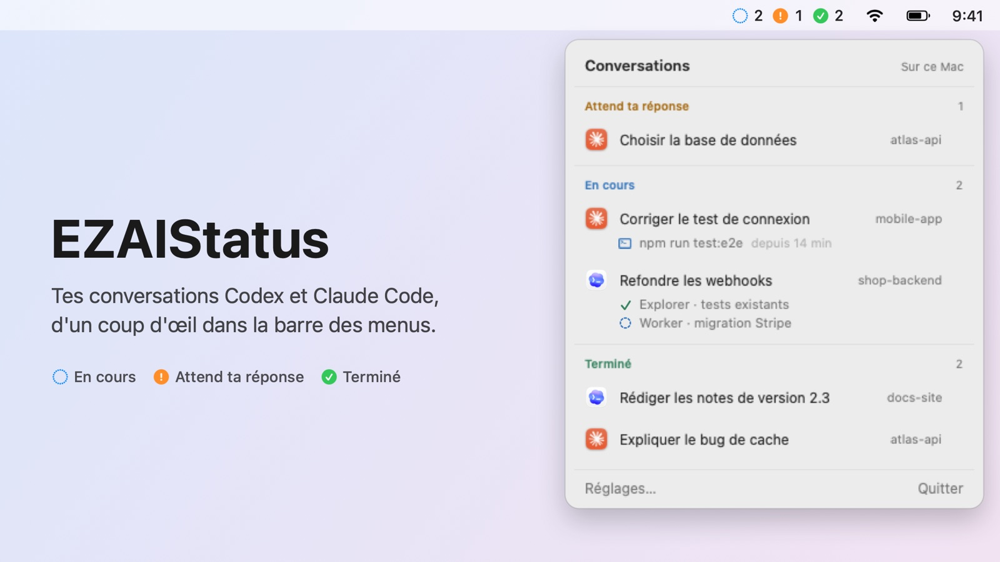

# EZAIStatus

*[English version](README.md)*

<picture>
  <source media="(prefers-color-scheme: dark)" srcset="docs/hero-fr-dark.jpg">
  
</picture>

Petite app de la barre des menus macOS qui montre combien de conversations de code avec une IA sont, sur ce Mac,
**en cours**, **en attente de ta réponse** ou **terminées** sans que tu aies lu la réponse. Un clic affiche les titres
groupés par état (attente en premier), avec le projet et les sous-agents ou commandes en arrière-plan actifs. Un clic sur
un titre ouvre directement la conversation.

Apps prises en charge : **Codex** (app ChatGPT) et **Claude Code** (app Claude). Les sous-agents s'affichent sous leur
conversation mais ne comptent jamais.

## Principes

- **Tout en local.** Lecture seule des fichiers des apps. Ni compte, ni serveur, ni réseau.
- **Léger.** Événements du système de fichiers (FSEvents) plutôt que sondage ; environ 1 % d'un cœur et 20 à 30 Mo de mémoire.
- **Honnête.** Une source illisible est signalée comme telle, jamais affichée comme zéro.
- **Discret par défaut.** L'historique est ignoré au premier lancement. Notifications et lancement à l'ouverture de session
  désactivés tant que tu ne les actives pas.
- **Interface en français et en anglais**, au choix dans les réglages.

Le seul fichier écrit hors de son dossier est le hook Claude Code facultatif (désactivé par défaut), qui détecte les
demandes d'autorisation d'outil. Activé dans les réglages, il ajoute une entrée à `~/.claude/settings.json`, après une copie
de sécurité.

Aucune de ces apps ne publie d'API pour ces états : EZAIStatus s'appuie sur leurs fichiers internes, qui peuvent changer à
chaque mise à jour. Notes techniques : [FAISABILITE.md](FAISABILITE.md).

## Configuration requise

macOS 14 ou plus récent, Apple Silicon ou Intel. Distribuée hors Mac App Store, dont le bac à sable interdit de lire les
fichiers des autres apps.

## Construire

```bash
swift test                       # tests du cœur
scripts/build-app.sh             # build/EZAIStatus.app, signature ad hoc pour ce Mac
scripts/build-app.sh --release   # signature Developer ID + runtime renforcé
scripts/notarize-xcode.sh        # notarisation avec le compte connecté dans Xcode, produit build/EZAIStatus.zip
scripts/publish-update.sh        # mise à jour Sparkle : notarise, puis zip + appcast signé dans build/updates/
swift scripts/make-icon.swift    # régénère Resources/AppIcon.icns
```

Diagnostic sans interface : `swift run ezaistatus-probe` (ou `--all`) affiche ce que voit chaque connecteur.

Les mises à jour automatiques passent par [Sparkle](https://sparkle-project.org) : l'app lit un appcast signé (EdDSA) dont
l'adresse et la clé publique viennent de `release.env`, et télécharge le zip depuis les Releases GitHub. Pour un fork, y mettre
ses propres valeurs ; laissées vides, les mises à jour sont désactivées.

## Touche Stream Deck

Le dossier `StreamDeck/` contient un plugin Stream Deck (7.1 ou plus récent) : une touche qui affiche les conversations en
cours (bleu), terminées non lues (vert) et une pastille orange si l'une attend ta réponse. Un appui ouvre la plus ancienne
conversation terminée, sinon le panneau. EZAIStatus écrit pour cela un petit fichier d'état local,
`~/Library/Application Support/EZAIStatus/status.json` ; sans l'app lancée, la touche affiche « hors ligne ».

```bash
cd StreamDeck
npm install && npm run build
npx streamdeck link dev.xprn.ezaistatus.sdPlugin   # puis glisser l'action « Agents IA » sur une touche
```

## Licence

[MIT](LICENSE)
